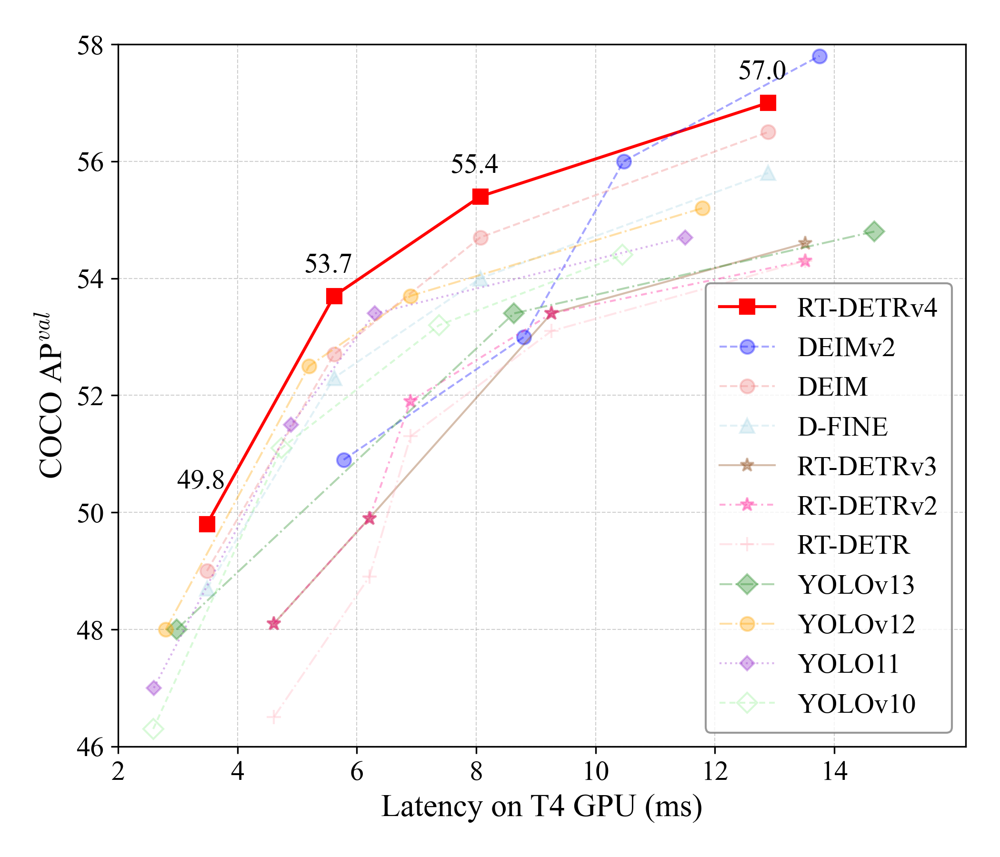

<h2 align="center">RT-DETRv4: Painlessly Furthering Real-Time Object Detection with Vision Foundation Models</h2>
<p align="center">
    <a href="https://github.com/RT-DETRs/RT-DETRv4/blob/main/LICENSE">
        
    </a>
    <a href="https://github.com/RT-DETRs/RT-DETRv4/pulls">
        
    </a>
    <a href="https://github.com/RT-DETRs/RT-DETRv4/issues">
        
    </a>
    <a href="https://github.com/RT-DETRs/RT-DETRv4">
        
    </a>
    <a href="https://arxiv.org/abs/2510.25257">
        
    </a>
    <a href="mailto:zjliao25@stu.pku.edu.cn">
        
    </a>
</p>

<p align="center">
  <strong>🎉 We are excited to announce that RT-DETRv4 has been accepted to ECCV 2026!</strong>
</p>

---

This is the official implementation of the paper:
* [RT-DETRv4: Painlessly Furthering Real-Time Object Detection with Vision Foundation Models](https://arxiv.org/abs/2510.25257)


## 🚀 Overview

**RT-DETRv4 is the new version of the state-of-the-art real-time object detector family, RT-DETR.** It introduces a cost-effective and adaptable distillation framework that leverages the powerful representations of Vision Foundation Models (VFMs) to enhance lightweight detectors.
<p align="center">
  
</p>
<details open>
<summary> 🎥 Demo: Furious 7 </summary>

We challenge **RT-DETRv4** with the high-speed scene from *Furious 7*. Even under extreme motion blur, rapid camera pans, and chaotic lighting, the model maintains consistent tracking and high recall, proving its reliability in dynamic environments.

<div align="center">

https://github.com/user-attachments/assets/e610b13b-a6bb-420b-ac6f-a752f61d0d84

</div>

</details>

## ⚡ Performance

RT-DETRv4 achieves new state-of-the-art results on the COCO dataset, outperforming previous real-time detectors.

| Model | AP | AP50 | AP75 | Latency (T4) | FPS (T4) | Config | Log | Checkpoint |
| :--- | :---: | :---: | :---: | :---: | :---: |:---------------------------------------------:|:----------------------------:|:---:|
| RT-DETRv4-S | 49.8 | 67.1 | 54.0 | 3.66 ms | 273 | [yml](./configs/rtv4/rtv4_hgnetv2_s_coco.yml) | [log](./logs/RTv4-S-hgnet.log) | [ckpt](https://drive.google.com/file/d/1jDAVxblqRPEWed7Hxm6GwcEl7zn72U6z) |
| RT-DETRv4-M | 53.7 | 71.0 | 58.4 | 5.91 ms | 169 | [yml](./configs/rtv4/rtv4_hgnetv2_m_coco.yml) | [log](./logs/RTv4-M-hgnet.log) | [ckpt](https://drive.google.com/file/d/1O-YpP4X-quuOXbi96y2TKkztbjroP5mX) |
| RT-DETRv4-L | 55.4 | 73.0 | 60.3 | 8.07 ms | 124 | [yml](./configs/rtv4/rtv4_hgnetv2_l_coco.yml) | [log](./logs/RTv4-L-hgnet.log) | [ckpt](https://drive.google.com/file/d/1shO9EzZvXZyKedE2urLsN4dwEv8Jqa_8) |
| RT-DETRv4-X | 57.0 | 74.6 | 62.1 | 12.90 ms | 78 | [yml](./configs/rtv4/rtv4_hgnetv2_x_coco.yml) | [log](./logs/RTv4-X-hgnet.log) | [ckpt](https://drive.google.com/file/d/19gnkMTgFveJsrOvSmEPQXCTG6v9oQHN3) |
## 📣 News

  * **[2026.06.18]** 🎉 RT-DETRv4 has been accepted to **ECCV 2026**! We sincerely thank all contributors and the community for your support!
  * **[2025.11.17]** Code, configs and checkpoints fully released! Thanks for your attention, and feel free to ask any questions!
  * **[2025.10.30]** Repo created, and code will be open-sourced very soon!

## Content

  * [1. Getting Started](#1-getting-started)
  * [2. Usage](#2-usage)
  * [3. Instance Segmentation](#3-instance-segmentation)
  * [4. Tools](#4-tools)
  * [5. Citation](#5-citation)
  * [6. Acknowledgement](#6-acknowledgement)

-----

> This repository also supports the reproduction of [DEIM](./configs/deim/), [D-FINE](./configs/dfine/), and [RT-DETRv2](./configs/rtv2/). Simply run the corresponding configuration files.

## 1\. Getting Started

### Setup

```shell
conda create -n rtv4 python=3.11.9
conda activate rtv4
pip install -r requirements.txt
```

### Data Preparation

<details>
<summary> COCO2017 Dataset </summary>

1.  Download COCO2017 from [OpenDataLab](https://opendatalab.com/OpenDataLab/COCO_2017) or [COCO](https://cocodataset.org/#download).
2.  Modify paths in [coco\_detection.yml](./configs/dataset/coco_detection.yml)

```yaml
train_dataloader:
    img_folder: /data/COCO2017/train2017/
    ann_file: /data/COCO2017/annotations/instances_train2017.json
val_dataloader:
    img_folder: /data/COCO2017/val2017/
    ann_file: /data/COCO2017/annotations/instances_val2017.json
```

</details>

<details>
<summary>Custom Dataset</summary>

To train on your custom dataset, you need to organize it in the COCO format. Follow the steps below to prepare your dataset:

1.  **Set `remap_mscoco_category` to `False`:**

    This prevents the automatic remapping of category IDs to match the MSCOCO categories.

    ```yaml
    remap_mscoco_category: False
    ```

2.  **Organize Images:**

    Structure your dataset directories as follows:

    ```shell
    dataset/
    ├── images/
    │   ├── train/
    │   │   ├── image1.jpg
    │   │   ├── image2.jpg
    │   │   └── ...
    │   ├── val/
    │   │   ├── image1.jpg
    │   │   ├── image2.jpg
    │   │   └── ...
    └── annotations/
        ├── instances_train.json
        ├── instances_val.json
        └── ...
    ```

      * **`images/train/`**: Contains all training images.
      * **`images/val/`**: Contains all validation images.
      * **`annotations/`**: Contains COCO-formatted annotation files.

3.  **Convert Annotations to COCO Format:**

    If your annotations are not already in COCO format, you'll need to convert them. You can use the following Python script as a reference or utilize existing tools:

    ```python
    import json

    def convert_to_coco(input_annotations, output_annotations):
        # Implement conversion logic here
        pass

    if __name__ == "__main__":
        convert_to_coco('path/to/your_annotations.json', 'dataset/annotations/instances_train.json')
    ```

4.  **Update Configuration Files:**

    Modify your [custom\_detection.yml](./configs/dataset/custom_detection.yml).

    ```yaml
    task: detection

    evaluator:
      type: CocoEvaluator
      iou_types: ['bbox', ]

    num_classes: 777 # your dataset classes
    remap_mscoco_category: False

    train_dataloader:
      type: DataLoader
      dataset:
        type: CocoDetection
        img_folder: /data/yourdataset/train
        ann_file: /data/yourdataset/train/train.json
        return_masks: False
        transforms:
          type: Compose
          ops: ~
      shuffle: True
      num_workers: 4
      drop_last: True
      collate_fn:
        type: BatchImageCollateFunction

    val_dataloader:
      type: DataLoader
      dataset:
        type: CocoDetection
        img_folder: /data/yourdataset/val
        ann_file: /data/yourdataset/val/ann.json
        return_masks: False
        transforms:
          type: Compose
          ops: ~
      shuffle: False
      num_workers: 4
      drop_last: False
      collate_fn:
        type: BatchImageCollateFunction
    ```

</details>

### Teacher Model Preparation

Our framework uses a pre-trained Vision Foundation Model (VFM) as the teacher. We use the **ViT-B/16-LVD-1689M** model from DINOv3.

  * **Repository:** [DINOv3](https://github.com/facebookresearch/dinov3)
  * **Weights:** [Downloads](https://ai.meta.com/resources/models-and-libraries/dinov3-downloads/)


### Configuring DINOv3 Teacher

Specify the paths to your local DINOv3 repository and the downloaded checkpoint in the model's configuration file `./configs/rtv4/rtv4_hgnetv2_${model}_coco.yml` and find the `teacher_model` section:

```yaml
teacher_model:
  type: "DINOv3TeacherModel"
  dinov3_repo_path: dinov3/
  dinov3_weights_path: pretrain/dinov3_vitb16_pretrain_lvd1689m.pth
```

Update the `dinov3_repo_path` and `dinov3_weights_path` to match your local setup.

## 2\. Usage

<details open>
<summary> COCO2017 </summary>

1.  Training

    ```shell
    CUDA_VISIBLE_DEVICES=0,1,2,3 torchrun --master_port=7777 --nproc_per_node=4 train.py -c configs/rtv4/rtv4_hgnetv2_${model}_coco.yml --use-amp --seed=0
    ```

2.  Testing

    ```shell
    CUDA_VISIBLE_DEVICES=0,1,2,3 torchrun --master_port=7777 --nproc_per_node=4 train.py -c configs/rtv4/rtv4_hgnetv2_${model}_coco.yml --test-only -r model.pth
    ```

3.  Tuning

    ```shell
    CUDA_VISIBLE_DEVICES=0,1,2,3 torchrun --master_port=7777 --nproc_per_node=4 train.py -c configs/rtv4/rtv4_hgnetv2_${model}_coco.yml --use-amp --seed=0 -t model.pth
    ```

</details>

<details>
<summary> Customizing Batch Size </summary>

For example, if you want to double the total batch size when training RT-DETRv4-L on COCO2017, here are the steps you should follow:

1.  **Modify your [dataloader.yml](./configs/base/dataloader.yml)** to increase the `total_batch_size`:

    ```yaml
    train_dataloader:
        total_batch_size: 64  # Previously it was 32, now doubled
    ```

2.  **Modify your [rtv4\_hgnetv2\_l\_coco.yml](./configs/rtv4/rtv4_hgnetv2_l_coco.yml)**. Here’s how the key parameters should be adjusted:

    ```yaml
    optimizer:
      type: AdamW
      params:
        -
          params: '^(?=.*backbone)(?!.*norm|bn).*$'
          lr: 0.000025  # doubled, linear scaling law
        -
          params: '^(?=.*(?:encoder|decoder))(?=.*(?:norm|bn)).*$'
          weight_decay: 0.

    lr: 0.0005  # doubled, linear scaling law
    betas: [0.9, 0.999]
    weight_decay: 0.0001  # need a grid search

    ema:  # added EMA settings
        decay: 0.9998  # adjusted by 1 - (1 - decay) * 2
        warmups: 500  # halved

    lr_warmup_scheduler:
        warmup_duration: 250  # halved
    ```

</details>

<details>
<summary> Customizing Input Size </summary>

If you'd like to train **RT-DETRv4** on COCO2017 with an input size of 320x320, follow these steps:

1.  **Modify your [dataloader.yml](./configs/base/dataloader.yml)**:

    ```yaml
    train_dataloader:
      dataset:
          transforms:
              ops:
                  - {type: Resize, size: [320, 320], }
      collate_fn:
          base_size: 320

    val_dataloader:
      dataset:
          transforms:
              ops:
                  - {type: Resize, size: [320, 320], }
    ```

2.  **Modify your [rtv4\_base.yml](./base/rtv4_base.yml)** (or the relevant base config file):

    ```yaml
    eval_spatial_size: [320, 320]
    ```

</details>

## 3. Instance Segmentation

This fork adds query-based instance segmentation to RT-DETRv4. The regular
detection configs remain unchanged; the mask head is enabled only in configs that
set `DFINETransformer.mask_dim` above zero. Set it to `0` to use the detector
without masks.

### Model and losses

The mask feature head upsamples the encoder's stride-8 feature map to stride 4.
Each decoder query produces a mask embedding, and the embedding is combined with
the mask features to produce a mask. Training adds binary cross-entropy and Dice
losses for matched queries. Evaluation reports both COCO `bbox` and `segm` metrics.

Implementation details are in [README_SEG.md](./README_SEG.md), and the mask head
is implemented in [engine/rtv4/mask_head.py](./engine/rtv4/mask_head.py).

### Dataset format

Use COCO instance annotations with a `segmentation` field containing polygons or
RLE masks. The dataset loader supports compressed RLE. Enable mask loading for the
training dataset with `return_masks: True`; the segmentation base config does this
for the training loader. Validation can use the annotation file for COCO mask
evaluation without loading mask tensors into the validation loader.

For a custom dataset, update the image and annotation paths in a dataset config,
set `num_classes`, and choose `remap_mscoco_category` to match your category IDs.
When remapping is disabled, category IDs are used as class indices. For example,
the included handoff config uses category IDs 1 (person) and 2 (clothing), with
`num_classes: 3` and class 0 unused. See
[configs/dataset/handoff_fullframe_seg.yml](./configs/dataset/handoff_fullframe_seg.yml).

### Train and evaluate

The included RT-DETRv4-S segmentation config is
[configs/rtv4_seg/rtv4_seg_hgnetv2_s_handoff.yml](./configs/rtv4_seg/rtv4_seg_hgnetv2_s_handoff.yml).
Its dataset paths point to the original handoff dataset location, so edit
`img_folder` and `ann_file` in the included dataset config for your machine before
training.

```shell
python train.py \
  -c configs/rtv4_seg/rtv4_seg_hgnetv2_s_handoff.yml \
  --use-amp --seed 0
```

The config uses a 640×640 input and an 80-epoch schedule. Checkpoints and logs are
written under `outputs/rtv4_seg_hgnetv2_s_handoff`. To evaluate a checkpoint:

```shell
python train.py \
  -c configs/rtv4_seg/rtv4_seg_hgnetv2_s_handoff.yml \
  --test-only -r outputs/rtv4_seg_hgnetv2_s_handoff/best_stg2.pth
```

### Export for DeepStream

The DeepStream exporter produces detections in the `NvDsInferParseYoloSeg` layout.
Install the deployment dependencies (`onnx`, `onnxruntime`, `onnxslim`, and
`scipy`) and export a trained checkpoint:

```shell
python tools/deployment/export_onnx_seg_deepstream.py \
  -c configs/rtv4_seg/rtv4_seg_hgnetv2_s_handoff.yml \
  -r outputs/rtv4_seg_hgnetv2_s_handoff/best_stg2.pth \
  --labels person clothing
```

The default output is `<checkpoint>_ds.onnx`, with input `input` (RGB float values
in `[0, 1]`) and output `output`. At 640×640, each detection row contains `x1, y1,
x2, y2, score, class_id` followed by a flattened 160×160 sigmoid mask aligned to
that detection's box. By default, the exporter subtracts one from category IDs so
IDs 1 and 2 map to labels 0 and 1. Use `--label-offset` if your dataset uses a
different category-ID convention. The exporter also compares ONNX Runtime output
with PyTorch output.

## 4\. Tools

<details>
<summary> Deployment </summary>

1.  Setup

    ```shell
    pip install onnx onnxsim
    ```

2.  Export onnx

    ```shell
    python tools/deployment/export_onnx.py --check -c configs/rtv4/rtv4_hgnetv2_${model}_coco.yml -r model.pth
    ```

3.  Export [tensorrt](https://docs.nvidia.com/deeplearning/tensorrt/install-guide/index.html)

    ```shell
    trtexec --onnx="model.onnx" --saveEngine="model.engine" --fp16
    ```

</details>

<details>
<summary> Inference (Visualization) </summary>

1.  Setup

    ```shell
    pip install -r tools/inference/requirements.txt
    ```

2.  Inference (onnxruntime / tensorrt / torch)

    Inference on images and videos is now supported.

    ```shell
    python tools/inference/onnx_inf.py --onnx model.onnx --input image.jpg  # or video.mp4
    python tools/inference/trt_inf.py --trt model.engine --input image.jpg
    python tools/inference/torch_inf.py -c configs/rtv4/rtv4_hgnetv2_${model}_coco.yml -r model.pth --input image.jpg --device cuda:0
    ```

</details>

<details>
<summary> Benchmark </summary>

1.  Setup

    ```shell
    pip install -r tools/benchmark/requirements.txt
    ```

2.  Model FLOPs, MACs, and Params

    ```shell
    python tools/benchmark/get_info.py -c configs/rtv4/rtv4_hgnetv2_${model}_coco.yml
    ```

3.  TensorRT Latency

    ```shell
    python tools/benchmark/trt_benchmark.py --COCO_dir path/to/COCO2017 --engine_dir model.engine
    ```

</details>

<details>
<summary> Fiftyone Visualization </summary>

1.  Setup

    ```shell
    pip install fiftyone
    ```

2.  Voxel51 Fiftyone Visualization ([fiftyone](https://github.com/voxel51/fiftyone))

    ```shell
    python tools/visualization/fiftyone_vis.py -c configs/rtv4/rtv4_hgnetv2_${model}_coco.yml -r model.pth
    ```

</details>

<details>
<summary> Others </summary>

1.  Auto Resume Training

    ```shell
    bash tools/reference/safe_training.sh
    ```

2.  Converting Model Weights

    ```shell
    python tools/reference/convert_weight.py model.pth
    ```

</details>

## 5\. Citation

If you find this work helpful, please consider citing:

```bibtex
@article{liao2025rtdetrv4,
  title={RT-DETRv4: Painlessly Furthering Real-Time Object Detection with Vision Foundation Models},
  author={Zijun Liao and Yian Zhao and Xin Shan and Yu Yan and Chang Liu and Lei Lu and Xiangyang Ji and Jie Chen},
  journal={arXiv preprint arXiv:2510.25257},
  year={2025}
}
```

## 6\. Acknowledgement

Our work is built upon [RT-DETR](https://github.com/lyuwenyu/RT-DETR), [D-FINE](https://github.com/Peterande/D-FINE), [DEIM](https://github.com/Intellindust-AI-Lab/DEIM) and Teacher Model [DINOv3](https://github.com/facebookresearch/dinov3).
Thanks to these remarkable works!
